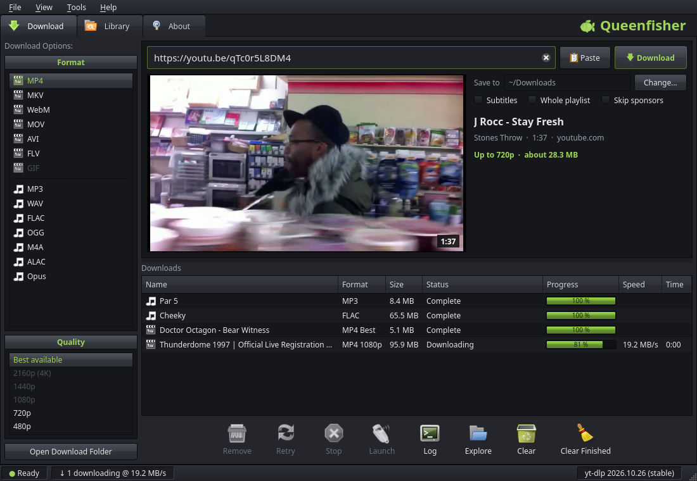
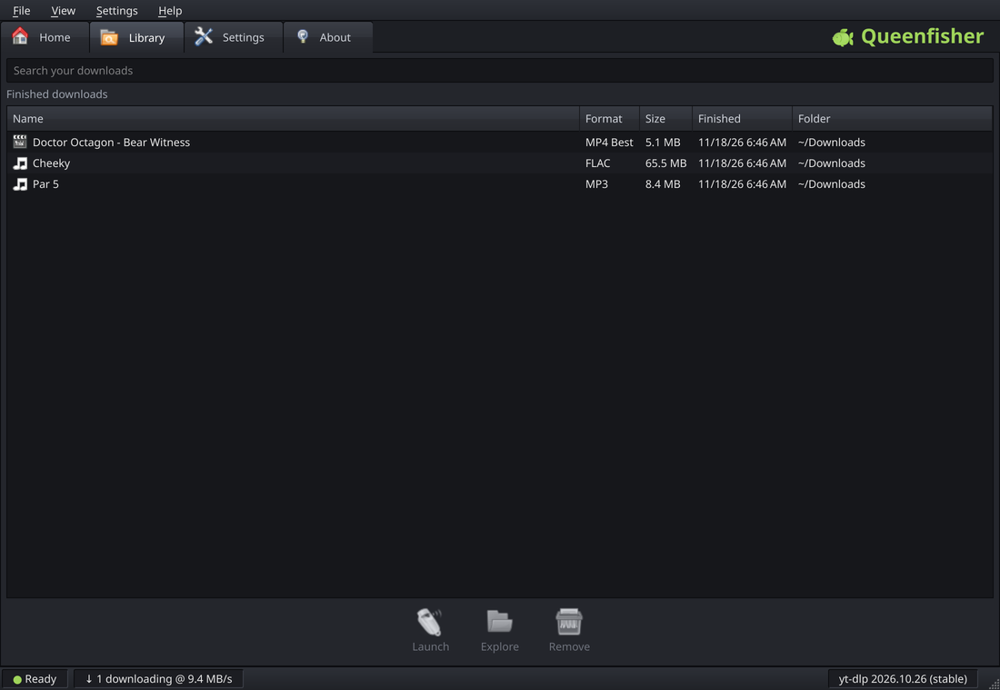
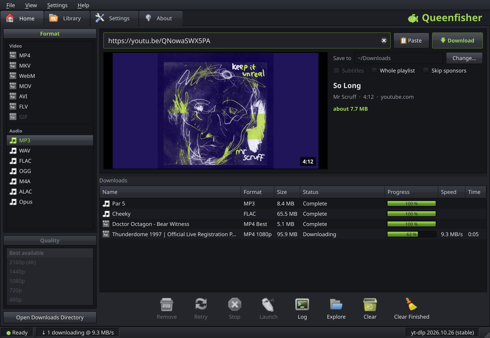

# Queenfisher

Free media downloader for Windows, macOS and Linux. Paste a link, pick a quality, done.



Queenfisher is a window around [yt-dlp](https://github.com/yt-dlp/yt-dlp), which does the actual downloading.

- Free and open source (GPLv3)
- No ads, no tracking, no account, nothing bundled
- Video as MP4, MKV, WebM, MOV, AVI, FLV or GIF; sound as MP3, WAV, FLAC, OGG, M4A, ALAC or the site's original

## How to use it

1. Copy a video link and click **Paste** (or press Ctrl+Shift+V). A preview shows the picture, the length, the qualities the video really has and roughly how big the file will be.
2. Pick a format and a quality on the left. Qualities the video doesn't have are greyed out.
3. Click **Download**. Add as many as you like; they download one after another, into your Downloads folder unless you pick another one with **Change...**.

Finished downloads stay in the **Library** tab, where you can search them, open them or show them in their folder.

## Features

- YouTube previews appear almost at once; other sites take a few seconds.
- Remembers your format, quality, folder and extras between sessions.
- Extras: English subtitles, whole playlists, and skipping sponsor segments (SponsorBlock).
- Downloading the same video again asks whether to keep the file you have or overwrite it. Another quality is saved as its own file.
- Unfinished pieces stay out of your download folder, so only the finished file appears there.
- Sits in the system tray when minimized, with download progress on hover.

| Library | Sound formats |
| --- | --- |
|  |  |

## Keeping yt-dlp working

Queenfisher keeps its own copy of yt-dlp and updates it for you.

- It downloads official yt-dlp releases from GitHub and only uses one after checking the yt-dlp developers' signature (key fingerprint `AC0C BBE6 848D 6A87 3464 AF4E 57CF 6593 3B5A 7581`) and the file's checksum.
- It checks for a new version once a day, between downloads.
- When a download fails in a way that usually means a site changed, it updates yt-dlp and tries again. If the newest release doesn't help, it switches to yt-dlp's nightly build, which tends to get site fixes first, and goes back to the regular release once that catches up.
- The previous copy is kept, and a new one has to start and report its version before it replaces the old one.

## Download

Get the newest version from [Releases](https://github.com/ArianARahimi/queenfisher/releases).

- **Linux:** download `Queenfisher-<version>-x86_64.AppImage`, make it executable (`chmod +x`) and run it.
- **Windows:** download `Queenfisher-<version>-windows.exe` and run it. It's the whole program; nothing to install or unpack. The first time, Windows may say it protected your PC: click **More info**, then **Run anyway**.
- **macOS:** download the `-macos.zip` (Apple Silicon) or `-macos-intel.zip` (Intel), open it and open Queenfisher. The first time, macOS blocks it: System Settings → Privacy & Security → **Open Anyway**.

Queenfisher uses [ffmpeg](https://ffmpeg.org/) to join video and sound and to convert between formats. On Windows it fetches yt-dlp's own build the first time (about 90 MB, checked against the release's SHA-256 checksums) and refreshes it every month; on Linux and macOS, install ffmpeg yourself. YouTube also needs [Deno](https://deno.com/): one you have installed is used, otherwise Queenfisher fetches the official build (about 45 MB, checked the same way) and keeps it up to date.

## Building

Needs Qt 6.5 or newer, OpenSSL 3, CMake and a C++20 compiler.

```
cmake -B build -G Ninja -DCMAKE_BUILD_TYPE=Release
cmake --build build
./build/queenfisher
```

To build the Linux AppImage (into `dist/`):

```
./packaging/linux/appimage.sh
```

To build the Windows `.exe` on Linux (MinGW, host Qt 6.12; builds a static Qt the first time):

```
./packaging/windows/build-static.sh
```

## Releases

GitHub Actions builds every push to `main`, checks each file on VirusTotal and puts it on the
"Latest build" pre-release for testing. A commit titled `Release vX.Y.Z`, with the same version in
`CMakeLists.txt`, also publishes that release. Nothing VirusTotal flags is published. The check
needs a VirusTotal API key in the repository secret `VT_API_KEY`.

## Known issues

- Fetching yt-dlp has been tested on Linux, Windows and macOS; updating it on Linux and Windows. Until Queenfisher's own copy is in place, it uses a yt-dlp installed on the computer, if there is one.
- On Linux and macOS, ffmpeg must be installed; Queenfisher only fetches its own on Windows.
- Fetching Queenfisher's own Deno has been tried on Windows and macOS (Intel); on Linux (used only when no Deno is installed) it hasn't been tried yet.
- The Mac apps aren't signed by Apple. The Intel build has been tried on macOS 26 (in a virtual machine); the Apple Silicon build hasn't been tried yet.
- When a site asks for a sign-in, Queenfisher retries once with your default browser's cookies. Finding the default browser works on Linux and Windows; on macOS it hasn't been tried yet, and Safari's cookies need Full Disk Access for Queenfisher (System Settings, Privacy & Security). On Windows, Chrome and Edge often lock their cookies away from other programs, so yt-dlp can't use them; Firefox-based browsers work.
- Clicking Download before the preview is in leaves the sound part's size to a guess, so the bar can jump a little when the sound starts.
- Checked on Linux (KDE) and Windows 11; the look on macOS is untested. The window frame and title bar are the system's own.
- YouTube previews show the picture and title right away, but the qualities and size still take a few seconds. Other sites take a few seconds for everything, since yt-dlp has to ask the site.
- The tray icon has been tried on KDE and Windows 11 (where it starts in the hidden icons, under the ^). GNOME shows tray icons only with an extension; without one, minimizing works as usual.
- AVI is re-encoded so old players can open it, which is slow for long videos. GIF is offered only for videos up to a minute, and even those make big files.
- Skip sponsors only works on YouTube, and only for segments the SponsorBlock community has marked.

## Credits

Icons from the [Tango Desktop Project](http://tango.freedesktop.org/) (public domain), see `resources/icons/COPYING-tango.txt`.

The fish icon is from Microsoft's [Fluent UI Emoji](https://github.com/microsoft/fluentui-emoji) (MIT License), see `packaging/COPYING-fish-icon.txt`.

## License

[GPL-3.0-or-later](LICENSE)
